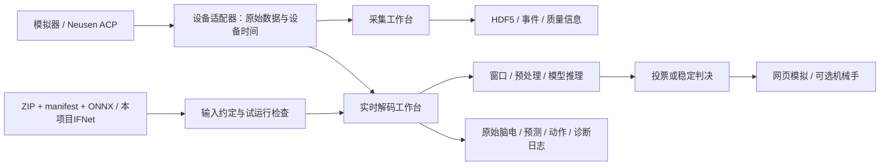

# 结构

- `handbci/studio/`：接收、阻抗、任务、事件、存储及采后查看。
- `handbci/continuous_online.py`、`continuous_ui/`：持续及有提示解码、判决、界面和输出生命周期。
- `handbci/model_bundle.py`：ONNX包校验、导入、输入预处理、连续推理和重置。
- `handbci/subject_online.py`：被试与模型登记，保持校验值和归属。
- `handbci/preprocess.py`：因果滤波、降采样、窗口支持范围。
- `handbci/prompted_control.py`：目标提示与事件，目标标签不进入模型输入。
- `handbci/hand_output.py`：可选动作执行及实际回读。

原特定被试的四类/六类模型适配器保留以供迁移研究，但公共版本不打包其权重、个人校准或来源数据；新用户通过通用导入入口使用自己的模型。
